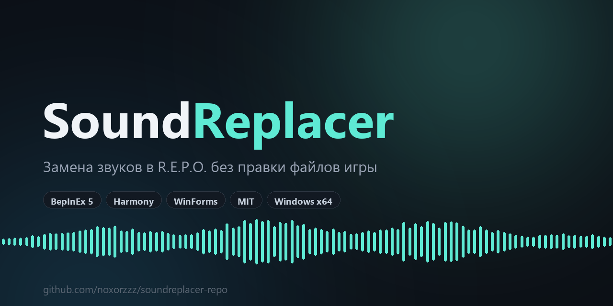
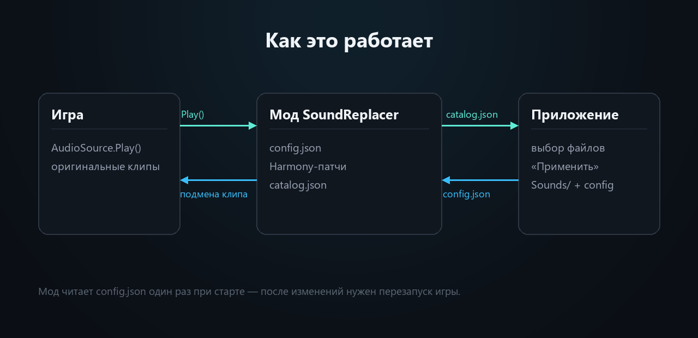

<div align="center">



# SoundReplacer

**Замена звуков в R.E.P.O. без правки файлов игры.**
Мод на BepInEx 5 + Harmony подменяет `AudioClip` по имени, приложение на WinForms даёт выбрать файлы, разложить их в `Sounds/` и записать `config.json`.

[](https://github.com/noxorzzz/soundreplacer-repo/actions/workflows/ci.yml)
[](LICENSE)


[](https://github.com/noxorzzz/soundreplacer-repo/releases/latest)
[](https://thunderstore.io/c/repo/p/noxorzzz/SoundReplacer/)

</div>

> [!WARNING]
> **Главное ограничение: замена клиентская.** В мультиплеере заменённые звуки слышат только те игроки, у которых установлен тот же мод и лежат те же файлы. Синхронизации нет: хост ничего не раздаёт, «ванильные» игроки слышат оригинал. Подробнее — [раздел 8](#8-мультиплеер--важно).

## Быстрый старт

| # | Шаг |
|---|---|
| 1 | Установите **BepInEx 5.4.x x64** в папку игры (рядом с `REPO.exe`) |
| 2 | Положите `SoundReplacer.dll` в `BepInEx/plugins/SoundReplacer/` |
| 3 | Запустите игру и закройте — мод соберёт `catalog.json` |
| 4 | Запустите **SoundReplacer.App** (готовый архив — в [Releases](https://github.com/noxorzzz/soundreplacer-repo/releases/latest)), выберите файлы → **«Применить»** |
| 5 | Перезапустите игру |

Полная пошаговая инструкция для игрока — **[docs/USAGE.md](docs/USAGE.md)**: установка, сбор каталога, выбор файлов, «Применить»/«Сбросить», разбор ошибок.

## Возможности

| Мод | Приложение |
|---|---|
| Подмена `AudioClip` по имени через 9 точек `AudioSource` | Список звуков из каталога, сортировка по частоте проигрывания |
| `.ogg` (Vorbis) и `.wav` (PCM 8–32 бит, float) | Выбор файла на каждый звук, «Очистить», «Сбросить» |
| Битый или отсутствующий файл → лог и оригинал, без падений | Поиск игры: процесс → Steam-библиотеки → вручную |
| `catalog.json` со счётчиком проигрываний | Копирование в `Sounds/` с хэшем, атомарная запись конфига |
| Свой лог с ротацией + `LogOutput.log` | Предупреждение о запущенной игре и перезапуске |

## Как это работает

<p align="center"></p>

Две части связаны только файловой системой: никаких сетевых вызовов, общего процесса и вызовов методов мода из приложения.

### Содержание

- [Инструкция для игрока](docs/USAGE.md)
- [Дорожная карта](ROADMAP.md)
- [Установка](#5-установка)
- [РЎР±РѕСЂРєР°](#6-СЃР±РѕСЂРєР°)
- [config.json](#7-configjson)
- [Мультиплеер](#8-мультиплеер--важно)
- [Диагностика](#10-диагностика)
- [Зависимости](#13-зависимости)
- [Thunderstore](#151-thunderstore)
- [Что проверено](#14-что-проверено-а-что-нет)

---

## 1. Предполагаемая версия игры и API

Код написан под следующие предположения (проверьте их на своём билде, см. ниже):

* **R.E.P.O.** — Steam Early Access, 64-bit Windows, **Unity 2022.3.x**, скриптовый бэкенд **Mono** (не IL2CPP).
* **BepInEx 5.4.22/5.4.23 x64** — плагин собирается под `net472`, ссылается на `BepInEx.dll` и `0Harmony.dll` из `BepInEx/core`.
* Патчатся публичные методы `AudioSource`, которые существуют начиная с Unity 5 и доступны в 2022.3:
  `Play()`, `Play(ulong)`, `PlayDelayed(float)`, `PlayScheduled(double)`, `PlayOneShot(AudioClip)`,
  `PlayOneShot(AudioClip, float)`, `PlayClipAtPoint(...)`, сеттер свойства `clip`.
  Для `.ogg` используется `UnityWebRequestMultimedia` (API стабилен с Unity 2020.2, где появился `UnityWebRequest.result`).

### Почему BepInEx 5, а не 6

| | BepInEx 5 | BepInEx 6 |
|---|---|---|
| Рантайм | Mono, .NET Framework 4.7.2 | IL2CPP (Il2CppInterop) или Mono |
| Harmony | 0Harmony 2.x «из коробки» | HarmonyX + interop-обёртки |
| Для R.E.P.O. | подходит, если игра на Mono | нужен только если игра на IL2CPP |
| Риск | минимальный | больше движущихся частей: interop-сборки, генерация прокси-типов, другие сигнатуры патчей |

Мод не использует ничего специфичного для IL2CPP, поэтому выбран BepInEx 5 — меньше зависимостей и выше шанс, что чужие моды на сервере/в сборке не конфликтуют.

### Как проверить Mono vs IL2CPP у себя

```text
<папка игры>\REPO_Data\Managed\Assembly-CSharp.dll        → Mono
<папка игры>\GameAssembly.dll + REPO_Data\il2cpp_data\... → IL2CPP
```

* Есть `Assembly-CSharp.dll` → берите **BepInEx 5 x64**, этот проект собирается как есть.
* Есть `GameAssembly.dll` → нужен **BepInEx 6 (IL2CPP)**, код придётся портировать (см. [раздел 11](#11-если-игра-оказалась-на-il2cpp)).

Версию Unity можно увидеть в `REPO_Data\globalgamemanagers` (или в логе игры/`Player.log`).

---

## 2. loaforcsSoundAPI: почему не используется

`loaforcsSoundAPI` — библиотека **под Lethal Company**: она регистрирует наборы замен из asset bundle и патчит `AudioSource` на Mono-рантайме. Под R.E.P.O. на момент написания **нет подтверждённого порта/совместимой сборки**, а тащить LC-версию нельзя: другой Unity, другие типы, другой конвейер ассетов.

Поэтому мод реализует **тот же принцип напрямую через Harmony**:

1. на старте игры читает `config.json`;
2. грузит пользовательские файлы в `AudioClip`;
3. складывает их в словарь `имя оригинального клипа → новый клип`;
4. на каждом `AudioSource.Play*`/`PlayOneShot` подменяет клип, если его имя есть в словаре.

В коде оставлена точка расширения:

* `mod/Audio/ISoundBackend.cs` — интерфейс бэкенда (`Install` / `Uninstall`);
* `mod/Audio/HarmonyAudioBackend.cs` — текущая реализация;
* `mod/SoundApiProbe.cs` — при старте пишет в лог, если в процессе найдена любая SoundAPI-сборка.

Если порт SoundAPI под R.E.P.O. появится: добавьте `SoundApiBackend : ISoundBackend`, который регистрирует замены в SoundAPI, и выберите его в `Plugin.Initialize()` вместо `HarmonyAudioBackend`. Патчи Harmony при этом можно не ставить.

---

## 3. Структура проекта

```text
R.E.P.O mod/
в”њв”Ђ README.md
в”њв”Ђ config.example.json
в”њв”Ђ SoundReplacer.sln                    # app + mod + tests
в”њв”Ђ .gitattributes
├─ .github/workflows/ci.yml             # тесты + сборка приложения
├─ docs/                                # banner, схема и инструкция USAGE.md
├─ thunderstore/                         # пакет для Thunderstore: manifest, icon, pack.ps1
├─ tests/SharedSmoke/                   # 26 дымовых проверок shared-слоя
├─ shared/                              # общий слой мода и приложения
│  ├─ Json.cs                           # свой мини-JSON (без NuGet и без конфликтов DLL)
│  ├─ ReplacerConfig.cs                 # модель config.json + атомарная запись
│  └─ SoundCatalog.cs                   # модель catalog.json
├─ mod/                                 # BepInEx-плагин
в”‚  в”њв”Ђ SoundReplacer.Mod.csproj
│  ├─ Plugin.cs                         # точка входа, чтение конфига, корутина загрузки
│  ├─ SoundApiProbe.cs                  # диагностика: есть ли SoundAPI в процессе
│  ├─ Logging/ModLog.cs                 # LogOutput.log + SoundReplacer.log (ротация)
в”‚  в”њв”Ђ Audio/
│  │  ├─ ISoundBackend.cs               # точка расширения под SoundAPI
│  │  ├─ HarmonyAudioBackend.cs         # Harmony-патчи AudioSource
│  │  ├─ AudioFileLoader.cs             # WAV-декодер (PCM/float, 8–32 бит)
│  │  └─ SoundReplacementManager.cs     # загрузка .ogg/.wav, словарь замен
│  └─ Catalog/CatalogCollector.cs       # сбор имён клипов → catalog.json
└─ app/                                 # WinForms-приложение
   в”њв”Ђ SoundReplacer.App.csproj
   в”њв”Ђ Program.cs
   ├─ MainForm.cs                       # вся логика: каталог, выбор файлов, apply/reset
   ├─ MainForm.Designer.cs              # разметка окна (без .resx)
   в””в”Ђ Services/
      в”њв”Ђ AppSettings.cs                 # %APPDATA%\SoundReplacer\settings.json
      ├─ GameLocator.cs                 # поиск игры: процесс → Steam-библиотеки
      ├─ GameProcessWatcher.cs          # запущена ли игра
      ├─ ModPaths.cs                    # пути BepInEx/plugins/SoundReplacer
      ├─ ConfigStore.cs                 # чтение/запись config.json + бэкап
      ├─ SoundFileValidator.cs          # проверка сигнатур OGG/WAV до записи конфига
      └─ SoundImporter.cs               # копирование в Sounds/ с хэшем в имени
```

Раскладка на диске после установки:

```text
<РёРіСЂР°>/
в”њв”Ђ REPO.exe
в”њв”Ђ BepInEx/
│  ├─ core/…                          # BepInEx 5
в”‚  в”њв”Ђ LogOutput.log
в”‚  в””в”Ђ plugins/
в”‚     в””в”Ђ SoundReplacer/
в”‚        в”њв”Ђ SoundReplacer.dll         # РјРѕРґ
│        ├─ config.json               # пишет приложение (читает мод)
│        ├─ config.previous.json      # бэкап предыдущего конфига
│        ├─ catalog.json              # пишет мод (читает приложение)
в”‚        в”њв”Ђ SoundReplacer.log
в”‚        в””в”Ђ Sounds/
в”‚           в”њв”Ђ Sfx_Item_Break_1a2b3c4d5e6f7a8b.ogg
│           └─ …
```

---

## 4. Как это работает

```text
  Игра запускается
        в”‚
        в–ј
  Plugin.Awake ──► читает config.json ──► грузит .ogg/.wav (корутина)
        в”‚                                   в”‚
        │                                   ├─ ошибка? → Warn в лог, оригинал остаётся
        в”‚                                   в–ј
        └──► Harmony-патчи AudioSource ──► словарь «имя клипа → клип»
                                              в”‚
   любой Play/PlayOneShot/PlayClipAtPoint ────┘
        в”‚
        в–ј
  имя клипа есть в словаре? ── да → играет заменённый клип
                            └─ нет → оригинал

  Параллельно мод собирает имена клипов ──► catalog.json
                                              в”‚
  SoundReplacer.App читает catalog.json ◄──────┘
        в”‚
        ├─ пользователь выбирает файлы
        ├─ «Применить» → копирует в Sounds/, пишет config.json
        └─ «Сбросить»  → пустой config.json, удаляет скопированные файлы
```

Конфиг читается **один раз при старте** — поэтому после «Применить» нужен перезапуск игры (приложение об этом предупреждает, если процесс игры запущен).

---

## 5. Установка

### 5.1. BepInEx 5

1. Скачайте `BepInEx_win_x64_5.4.23.x.zip` (BepInEx 5, x64, Mono).
2. Распакуйте в папку игры рядом с `REPO.exe` (должны появиться `winhttp.dll`, `doorstop_config.ini`, папка `BepInEx`).
3. Запустите игру один раз и закройте — BepInEx создаст `BepInEx/LogOutput.log`.

### 5.2. РњРѕРґ

Проще всего — **[Thunderstore](https://thunderstore.io/c/repo/p/noxorzzz/SoundReplacer/)** (`noxorzzz/SoundReplacer`, версия 1.0.0): ставится через r2modman / Thunderstore Mod Manager, BepInEx он подтянет сам, вместе с зависимостью `BepInEx-BepInExPack-5.4.2305`.

Вручную — соберите проект (раздел 6) или возьмите готовый `SoundReplacer.dll` и положите сюда:

```text
<РёРіСЂР°>/BepInEx/plugins/SoundReplacer/SoundReplacer.dll
```

Папку `SoundReplacer` создайте сами — мод и приложение используют её как рабочую.

Проверка: запустите игру, в `BepInEx/LogOutput.log` должно появиться:

```text
[Info   :   SoundReplacer] SoundReplacer 1.0.0 стартует из ...\BepInEx\plugins\SoundReplacer
[Info   :   SoundReplacer] Harmony backend: установлено патчей 9, недоступно 0
```

и рядом с DLL появятся `SoundReplacer.log` и `catalog.json`.

### 5.3. Приложение

* Скачайте артефакт **`SoundReplacer.App-win-x64`** из GitHub Actions (workflow `ci` → job `shared tests + WinForms app` → Artifacts): внутри папка `net10.0-windows` с exe. Для запуска нужен **.NET 10 Desktop Runtime**, либо
* соберите/опубликуйте сами (раздел 6). Для раздачи друзьям удобнее self-contained публикация — тогда .NET ставить не нужно.

Запустите приложение. Оно попробует найти игру сама (по запущенному процессу, затем по библиотекам Steam). Если не нашла — «Обзор…» и укажите папку с `REPO.exe`.

---

## 6. РЎР±РѕСЂРєР°

### РњРѕРґ

```powershell
dotnet build .\mod\SoundReplacer.Mod.csproj -c Release -p:GameDir="D:\SteamLibrary\steamapps\common\REPO"
```

* `GameDir` нужен только для ссылок на `BepInEx.dll`, `0Harmony.dll` и DLL Unity; после сборки DLL автоматически копируется в `BepInEx/plugins/SoundReplacer`.
* Отключить копирование: `-p:CopyToGame=false`.
* Если BepInEx не установлен в папку игры (моды идут через профиль r2modman/Thunderstore Mod Manager), передайте папку ядра: `-p:BepInExCore="…\profiles\Default\BepInEx\core"`.
* Unity 2022.3 собирает сборки игры под .NET Standard 2.1, поэтому без .NET Framework 4.7.2 Targeting Pack сборка идёт против Mono-сборок самой игры — так надёжнее:

```powershell
dotnet build .\mod\SoundReplacer.Mod.csproj -c Release `
  -p:GameDir="J:\SteamLibrary\steamapps\common\REPO" `
  -p:BepInExCore="…\BepInEx\core" `
  -p:CopyToGame=false `
  -p:FrameworkPathOverride="J:\SteamLibrary\steamapps\common\REPO\REPO_Data\Managed" `
  -p:AutomaticallyUseReferenceAssemblyPackages=false
```

* Если папка игры называется иначе (`REPO_Data` отсутствует) — поправьте `ManagedDir` в `mod/SoundReplacer.Mod.csproj`.
* `dotnet build` без флагов работает и на чистой машине: SDK скачает reference assemblies с NuGet (нужен интернет).

### Приложение

```powershell
dotnet build .\app\SoundReplacer.App.csproj -c Release

# вариант «без установленного .NET»:
dotnet publish .\app\SoundReplacer.App.csproj -c Release -r win-x64 -p:SelfContained=true `
  -p:PublishSingleFile=true -p:IncludeNativeLibrariesForSelfExtract=true
```

---

## 7. config.json

Путь: `BepInEx/plugins/SoundReplacer/config.json`. Пишет приложение, читает мод. Полный пример — [`config.example.json`](config.example.json).

```json
{
  "version": 1,
  "enabled": true,
  "patchClipSetter": true,
  "exportCatalog": true,
  "matchLength": true,
  "matchVolume": true,
  "matchChannels": true,
  "sounds": {
    "Sfx - Item Break": "Sounds/Sfx_Item_Break_1a2b3c4d5e6f7a8b.ogg",
    "Music - Menu": "Sounds/Music_Menu_9f8e7d6c5b4a3921.wav",
    "Sfx - Player Hurt": "C:\\MySounds\\hurt.ogg"
  }
}
```

| Поле | Тип | По умолчанию | Смысл |
|---|---|---|---|
| `version` | int | `1` | версия схемы, для будущих миграций |
| `enabled` | bool | `true` | глобальный выключатель замен |
| `patchClipSetter` | bool | `true` | патчить сеттер `AudioSource.clip` (ловит «положил клип → потом Play()»). Если какой-то мод/игра странно себя ведёт — поставьте `false` |
| `exportCatalog` | bool | `true` | собирать `catalog.json` |
| `matchLength` | bool | `true` | обрезать файл до длительности оригинала: длинный звук не продолжается после события |
| `matchVolume` | bool | `true` | приводить пик файла к пику оригинального клипа (громкость не скачет) |
| `matchChannels` | bool | `true` | сводить стерео в моно, если оригинал моно — иначе 3D-панорама не работает |
| `sounds` | object | `{}` | маппинг `точное имя AudioClip → путь к .ogg/.wav` |

Правила:

* **Ключ** — точное имя `AudioClip.name`, с учётом регистра и пробелов. Список реальных имён даёт `catalog.json` (и приложение).
* **Путь** может быть относительным (от папки мода; приложение всегда пишет `Sounds/...`) или абсолютным.
* Поддерживаются `.ogg` (Vorbis) и `.wav` (PCM 8/16/24/32 бит или IEEE-float 32 бита, 1–2 канала, до 120 секунд, до 200 МБ).
* **Длина, громкость и каналы подгоняются автоматически** под оригинал (см. `matchLength`, `matchVolume`, `matchChannels`). Пространственные эффекты — затухание по расстоянию, позиция на карте, реверберация, микшер — не трогаются: меняется только `AudioClip`, а `AudioSource` остаётся штатным, поэтому звук ведёт себя на карте так же, как оригинал.
* Ogg **Opus** не поддерживается — Unity декодирует только Vorbis; приложение отбракует такой файл заранее.
* Нет файла / битый файл / неизвестное расширение → мод пишет `WARN` в оба лога, **оригинальный звук остаётся**, игра не падает.
* Битого `config.json` (невалидный JSON, `sounds` не объект) → мод пишет `ERROR`, работает без замен.
* Приложение делает атомарную запись (временный файл + подмена) и оставляет `config.previous.json`.

### catalog.json

Пишет мод, читает приложение:

```json
{
  "version": 1,
  "generatedUtc": "2026-11-15T05:40:00.0000000Z",
  "gameVersion": "0.2.1",
  "unityVersion": "2022.3.62f1",
  "modVersion": "1.0.0",
  "sounds": [
    { "name": "Sfx - Footstep Concrete", "plays": 340, "lastSeenUtc": "2026-11-15T05:36:00Z" }
  ]
}
```

Имена берутся из реальных `AudioClip` (загруженные ресурсы + каждый факт проигрывания), поэтому список полный только после того, как вы поиграли. `plays` — счётчик проигрываний, по нему приложение сортирует список (сверху самые частые). Файл обновляется не чаще раза в 10 секунд и при выходе из игры.

---

## 8. Мультиплеер — ВАЖНО

* Замена **только на вашем клиенте**. Ничего не отправляется по сети.
* Другие игроки услышат ваш кастомный звук **только если у них установлен SoundReplacer и лежат те же файлы** (совпадающие имена звуков в конфиге).
* Игроки без мода слышат **оригинальные** звуки. Хост/сервер мод не требует.
* **Синхронизации нет** — это осознанное ограничение текущей версии. Что можно сделать вручную: раздать друзьям папку `BepInEx/plugins/SoundReplacer` (config + Sounds) и попросить положить её по тому же пути.
* Голосовой чат и проксимити-голос мод не трогает: это отдельный аудиопоток, а не `AudioClip`-ы игры.
* Не используйте мод, чтобы выдавать себя за другого игрока или обходить правила конкретного сервера/сообщества.

Возможное развитие (не реализовано): обмен по хэшу файла + автоскачивание у хоста, но это уже сетевая подсистема и отдельный протокол.

---

## 9. Ограничения и известные особенности

* Имя клипа должно совпадать **точно**. Регистр и пробелы важны.
* Загрузка асинхронная: в первые кадры после загрузки сцены часть звуков может прозвучать оригиналом.
* `AudioSource.Play*` — единственный перехватываемый путь. Если звук играется не через `AudioSource` (FMOD/Wwise/`VideoPlayer`/`AudioClip.Play` через `AudioSource`-пул — покрывается), замена не сработает. В R.E.P.O. аудио идёт через `AudioSource`, но конкретный билд стоит проверить.
* Патч `set_clip` может подменить клип, который игра использует не для проигрывания (например, сравнивает по имени). При странном поведении: `"patchClipSetter": false`.
* Ограничения файлов: > 200 МБ, WAV > 120 с, > 2 каналов, Ogg Opus — отклоняются с записью в лог.
* Мод не перечитывает конфиг на лету: изменения — после перезапуска игры (приложение предупреждает).
* Приложение удаляет только файлы **внутри** `Sounds/`; абсолютные пути из конфига игнорируются при очистке.
* Мод не трогает файлы игры: оригинальные ассеты остаются на месте, «сброс» — это просто пустой конфиг.

---

## 10. Диагностика

Логи:

* `BepInEx/LogOutput.log` — общий лог BepInEx (мод дублирует туда все сообщения);
* `BepInEx/plugins/SoundReplacer/SoundReplacer.log` — отдельный лог мода с ротацией (`.1`, до 4 МБ).

| Симптом | Что проверить |
|---|---|
| В логе нет строк SoundReplacer | BepInEx 5 vs 6; DLL лежит в `BepInEx/plugins/SoundReplacer/`; в `LogOutput.log` есть `Loading [SoundReplacer]` |
| `config.json не найден` | нажмите «Применить» в приложении; проверьте, что путь игры в приложении тот же |
| `звук 'X' не заменён: файл не найден` | файл переименован/удалён; нажмите «Применить» заново |
| `Unity не смог декодировать OGG` | это Opus или битый Ogg; перекодируйте в Vorbis |
| Звук не меняется, ошибок нет | имя клипа не совпадает; проверьте `catalog.json`; попробуйте `patchClipSetter: false`; звук может играть не через AudioSource |
| Заменился не тот звук | два клипа с одинаковым именем; уточните имя по каталогу, смотрите `plays` |
| Приложение не находит игру | «Обзор…» → папка с `REPO.exe`; путь сохраняется в `%APPDATA%\SoundReplacer\settings.json` |
| «BepInEx не установлен» | распакуйте BepInEx 5 в папку игры (рядом с `REPO.exe`) |

Приложение при старте пишет в статусную строку, сколько звуков в каталоге и сколько замен в конфиге.

---

## 11. Если игра оказалась на IL2CPP

Понадобится BepInEx 6 (bleeding edge) + Il2CppInterop. Что менять:

1. TFM проекта: `netstandard2.1` или `net6.0`, ссылки — `BepInEx.Unity.IL2CPP.dll`, `Il2CppInterop.Runtime.dll`, `0Harmony.dll` из `BepInEx/core`.
2. `[BepInPlugin]` остаётся, но `BaseUnityPlugin` берётся из `BepInEx.Unity.IL2CPP`.
3. Типы Unity (`AudioSource`, `AudioClip`) — IL2CPP-прокси; `ref AudioClip` в Harmony-патчах работает, но иногда требует `Il2CppReferenceArray`/`IntPtr`-обёрток — проверяйте по месту.
4. `UnityWebRequestMultimedia.GetAudioClip` в IL2CPP может быть недоступен напрямую: либо декодируйте OGG сами (NVorbis/NAudio), либо используйте `DownloadHandlerAudioClip` через interop.
5. `AudioClip.Create` + `SetData` в IL2CPP доступны, WAV-путь переносится почти без изменений.

Проверять это стоит только если `Assembly-CSharp.dll` действительно нет.

---

## 12. Как искать звуки и методы в декомпилированном коде

Инструменты: **dnSpyEx** (удобнее для Mono: точки останова, правка на лету) или **ILSpy**. Открывать `<игра>/REPO_Data/Managed/Assembly-CSharp.dll`.

1. **Имена клипов.** Самый быстрый путь — уже собранный `catalog.json`: поиграйте 10–15 минут, откройте приложение, отсортируйте по `plays`. Для полного списка ассетов: **AssetRipper** на папке `REPO_Data` → экспорт `AudioClip`, имена совпадают с `clip.name`.
2. **Где играет звук.** Ищите по `Assembly-CSharp`:
   * `AudioSource.PlayOneShot`, `AudioSource.Play`, `PlayClipAtPoint`;
   * классы `AudioManager`, `SoundManager`, `SoundHandler`, `SFX`, `Music`, `Sound`;
   * строковые литералы с именами клипов (`Sfx - …`) — по ним видно, какой класс что запускает.
3. **Кто владеет клипом.** В декомпиле найдите поле/свойство `AudioClip` и посмотрите, откуда берётся (`Resources.Load<AudioClip>("...")`, `AssetBundle.LoadAsset`, `Addressables`). Имя, которое вернёт `clip.name`, — это имя ассета без пути.
4. **Проверка гипотезы.** В dnSpy поставьте breakpoint на `AudioSource.PlayOneShot`, запустите игру, посмотрите `clip.name` в Locals. Если имя совпало с ключом в конфиге — замена сработает.
5. **Если клип не находится.** Добавьте временное логирование в `CatalogCollector.Observe` (имя + `clip.GetInstanceID()`), либо в `HarmonyAudioBackend.SourcePlayPatch` — так видно все имена, которые реально проходят через AudioSource.
6. **Если звук идёт не через AudioSource.** Ищите `AudioClip.Play`, `PlayScheduled` на `AudioSettings`, FMOD/Wwise-обёртки. Для таких путей нужен отдельный патч (и это уже другая задача).

---

## 13. Зависимости

### РњРѕРґ

| Зависимость | Откуда | Зачем |
|---|---|---|
| BepInEx 5.4.22/5.4.23 x64 | установлен в игру | загрузка плагина, `Paths`, логирование |
| `BepInEx.dll` | `BepInEx/core` | `BaseUnityPlugin`, `ManualLogSource` |
| `0Harmony.dll` (Harmony 2.x) | `BepInEx/core` | патчи `AudioSource` |
| `UnityEngine.dll`, `UnityEngine.CoreModule.dll`, `UnityEngine.AudioModule.dll` | `REPO_Data/Managed` | `AudioSource`, `AudioClip` |
| `UnityEngine.UnityWebRequestModule.dll`, `UnityEngine.UnityWebRequestAudioModule.dll` | `REPO_Data/Managed` | декодирование `.ogg` |
| .NET Framework 4.7.2 Targeting Pack | SDK/VS | СЃР±РѕСЂРєР° `net472` |

NuGet-пакеты моду **не нужны** (JSON свой, см. `shared/Json.cs`).

### Приложение

| Зависимость | Зачем |
|---|---|
| .NET 10 Desktop Runtime (или self-contained publish) | WinForms |
| `System.Security.Cryptography` (в составе BCL) | SHA-256 в имени файла |

NuGet-пакеты приложению **не нужны**.

### SoundAPI

Не требуется и не используется: на момент написания нет подтверждённого порта под R.E.P.O. См. раздел 2.

---

## 14. Что проверено, а что нет

Проверено в этом репозитории:

* `shared/` (JSON, config, catalog): 26 проверок в `tests/SharedSmoke` (локально и в CI) — round-trip с кириллицей/кавычками/пробелами, отказ битого JSON, атомарная запись без `.tmp`, загрузка отсутствующего файла.
* Мод: компилируется без ошибок и предупреждений против стабов API Unity/BepInEx/Harmony (реальные DLL игры в этой среде отсутствуют).
* Приложение: собирается без ошибок и предупреждений (`net10.0-windows`), логика каталога/импорта/сброса покрыта кодом, UI вживую не прокликивался (нет запущенной игры для реалистичного сценария).
* CI (`.github/workflows/ci.yml`) собирает приложение и гоняет эти тесты на `windows-latest`.

Не проверено (нужен ваш билд игры):

* фактическая замена звука в R.E.P.O. — имена клипов, конкретные пути проигрывания, поведение `set_clip` в этом билде;
* точная версия Unity/бинаря игры;
* поведение в мультиплеере.

Первый запуск — по чек-листу: `LogOutput.log` → строка о загрузке мода → `Harmony backend: 9` → `catalog.json` появился → в приложении виден список → «Применить» → перезапуск → звук изменился.

---

## 15. Репозиторий и CI

Репозиторий (приватный): `https://github.com/noxorzzz/soundreplacer-repo`.

```bash
git clone https://github.com/noxorzzz/soundreplacer-repo.git
```

Что делает CI (`.github/workflows/ci.yml`, `windows-latest`, .NET 10):

1. `dotnet run --project tests/SharedSmoke` — 26 дымовых проверок shared-слоя;
2. `dotnet build app/SoundReplacer.App.csproj -c Release` — сборка WinForms-приложения;
3. artifact `SoundReplacer.App-win-x64` — готовая папка с exe.

Мод в CI не собирается: без установленной игры нет `BepInEx.dll`, `0Harmony.dll` и DLL Unity. Сборка мода — только локально (`dotnet build mod/... -p:GameDir=...`, раздел 6).

Релизы: https://github.com/noxorzzz/soundreplacer-repo/releases — `v1.0.1` (приложение из CI) и `v1.0.0` (первый релиз мода).

Ревизия: поднимите версию в `mod/Plugin.cs` (`PluginVersion`), `app/SoundReplacer.App.csproj` (`Version`) и `CHANGELOG.md`, затем

```bash
git tag v1.0.1
git push origin main --tags
```

и приложите к GitHub Release `SoundReplacer.dll`, `config.example.json` и README.

### 15.1. Thunderstore

Пакет опубликован: **[thunderstore.io/c/repo/p/noxorzzz/SoundReplacer](https://thunderstore.io/c/repo/p/noxorzzz/SoundReplacer/)** — версия `1.0.0`, namespace `noxorzzz`, сообщество `repo`, зависимость `BepInEx-BepInExPack-5.4.2305`.

Пакет для [Thunderstore](https://thunderstore.io/c/repo/) лежит в `thunderstore/`:

* `manifest.json` — имя `SoundReplacer`, зависимость `BepInEx-BepInExPack-5.4.2305`;
* `icon.png` — 256×256;
* `README.md` и `CHANGELOG.md` — страница пакета;
* `pack.ps1` — собирает мод и пакует `dist/noxorzzz-SoundReplacer-<version>.zip`.

Сборка пакета (нужна установленная игра):

```powershell
cd thunderstore
.\pack.ps1 -GameDir "D:\SteamLibrary\steamapps\common\REPO"
```

Загрузка вручную: https://thunderstore.io/c/repo/create/ (команда `noxorzzz`) или

```powershell
dotnet tool install -g tcli
tcli publish --file dist/noxorzzz-SoundReplacer-1.0.0.zip --token <API_TOKEN>
```

Для публичной страницы репозиторий должен быть публичным — иначе ссылки на приложение из README пакета не откроются у игроков.

## 16. Правовая заметка

Мод не содержит и не распространяет ассеты R.E.P.O. Заменяйте только те файлы, права на которые у вас есть. Не выкладывайте извлечённые из игры звуки в общий доступ. Уважайте правила серверов и сообщества игры.